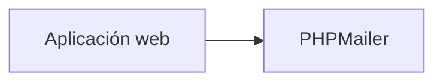
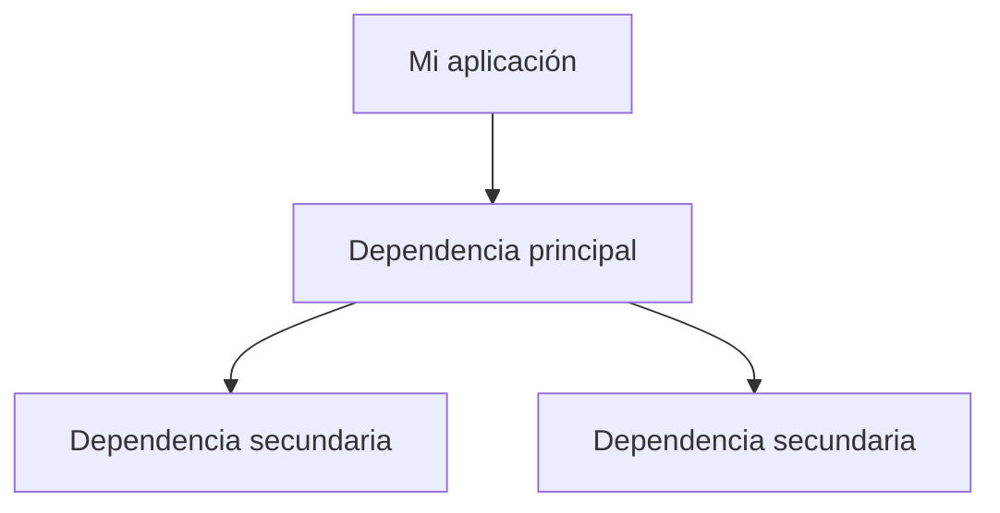

# Gestión de dependencias

## Introducción

En el apartado anterior hemos visto que los frameworks modernos están formados por numerosos componentes reutilizables.

Sin embargo, los frameworks no son el único ejemplo de reutilización de código. Los desarrolladores utilizan constantemente librerías creadas por terceros para incorporar funcionalidades complejas a sus aplicaciones sin tener que desarrollarlas desde cero.

Estas librerías reciben el nombre de **dependencias**.

Comprender qué son las dependencias y cómo gestionarlas correctamente es una habilidad fundamental para cualquier desarrollador web.

---

## ¿Qué es una dependencia?

Una dependencia es un recurso software externo que una aplicación necesita para funcionar correctamente.

Puede tratarse de:

- Una librería.
- Un paquete.
- Un componente.
- Un framework.
- Una herramienta de terceros.

!!! info "Definición"
    Una dependencia es cualquier componente externo que una aplicación necesita para proporcionar una determinada funcionalidad.

---

## Un ejemplo real

Imagina que estás desarrollando una tienda online y necesitas enviar correos electrónicos a los clientes cuando realizan un pedido.

Por ejemplo:

- PHPMailer
- Symfony Mailer

La mayoría de desarrolladores optaría por utilizar una librería ya existente y ampliamente probada.



---

## Otros ejemplos de dependencias habituales

### Generación de documentos PDF

- Dompdf
- TCPDF
- mPDF

### Registro de eventos (logs)

- Monolog

### Manipulación de imágenes

- Imagine
- Intervention Image

### Consumo de APIs

- Guzzle

---

## Dependencias directas e indirectas

### Dependencia directa

Es aquella que el desarrollador instala manualmente.

```text
PHPMailer
```

### Dependencia indirecta

Son las dependencias que se instalan automáticamente porque la dependencia principal las necesita.



!!! note "Observa"
    En proyectos reales es frecuente utilizar decenas o incluso cientos de dependencias indirectas.

---

## Problemas de la gestión manual

- Instalación compleja.
- Actualizaciones difíciles.
- Dependencias incompatibles.
- Mayor riesgo de errores.

---

## La solución: gestores de dependencias

| Lenguaje | Gestor de dependencias |
|-----------|-----------|
| PHP | Composer |
| JavaScript | npm |
| Python | pip |
| Java | Maven |
| C# | NuGet |

---

## ¿Qué ocurre cuando instalamos una dependencia?

Cuando ejecutamos un comando como:

```bash
composer require monolog/monolog
```

Composer realiza automáticamente varias tareas que normalmente tendríamos que hacer manualmente.

<div class="grid cards" markdown>

-   :material-hand-pointing-right:

    **Solicitud**

    El desarrollador indica qué paquete desea instalar.

    ```bash
    composer require monolog/monolog
    ```

-   :material-magnify:

    **Búsqueda**

    Composer consulta **Packagist** y localiza el paquete solicitado.

-   :material-download:

    **Descarga**

    Se descargan los archivos de la librería seleccionada.

-   :material-link-variant:

    **Resolución de dependencias**

    Composer identifica e instala automáticamente los paquetes adicionales necesarios.

-   :material-file-document:

    **Actualización**

    Se actualizan automáticamente:

    - `composer.json`
    - `composer.lock`

-   :material-lightning-bolt:

    **Autoload**

    Composer genera el sistema de carga automática de clases.

    ```text
    vendor/autoload.php
    ```

-   :material-check-circle:

    **Listo para usar**

    La dependencia queda instalada y preparada para utilizarse en el proyecto.

</div>

!!! success "Ventaja principal"
    Todo este proceso se realiza mediante un único comando, evitando descargas manuales, errores de versión e incompatibilidades entre librerías.

---

## Dependencias y trabajo en equipo

!!! tip "Buenas prácticas"
    Utiliza siempre un gestor de dependencias para garantizar que todos los desarrolladores trabajan con las mismas versiones.

---

## Hacia Composer

PHP utiliza actualmente una herramienta estándar para gestionar dependencias: **Composer**.

Composer permite:

- Crear proyectos.
- Instalar librerías.
- Actualizar dependencias.
- Automatizar la carga de clases.
- Gestionar versiones de paquetes.

---

## Resumen

- Una dependencia es un componente externo utilizado por una aplicación.
- Existen dependencias directas e indirectas.
- Los gestores de dependencias automatizan la instalación y mantenimiento de paquetes.
- Composer es el gestor de dependencias utilizado actualmente en PHP.

!!! success "Has completado este apartado"
    Ya comprendes por qué es necesario gestionar dependencias en proyectos modernos. En el siguiente apartado comenzarás a trabajar con Composer.
