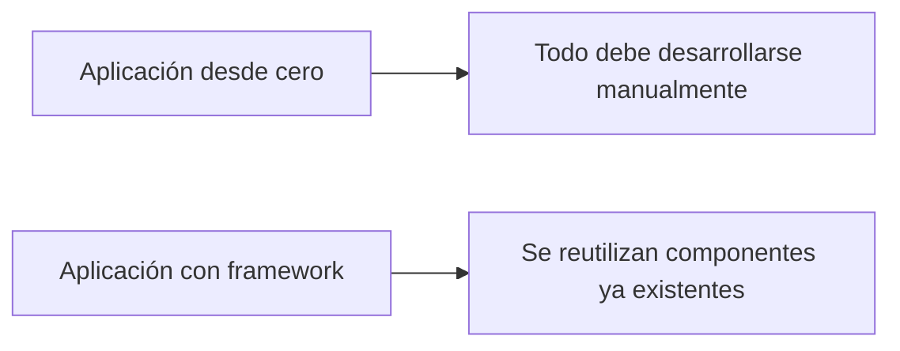
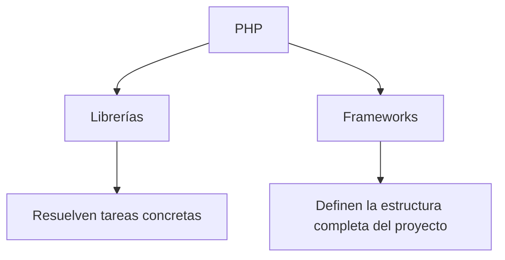
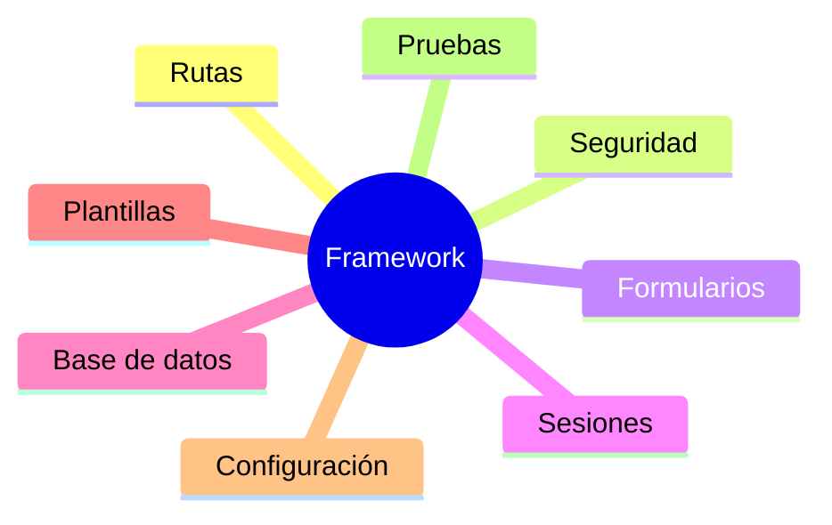

# Introducción a los frameworks

## ¿Qué es un framework?

Cuando comenzamos a desarrollar aplicaciones web, es habitual crear todo el código desde cero: formularios, validaciones, acceso a bases de datos, gestión de sesiones o control de usuarios.

Este enfoque resulta adecuado para aprender, pero a medida que las aplicaciones crecen aparecen nuevos desafíos:

- El código se vuelve más complejo.
- Aumenta el tiempo de desarrollo.
- Resulta más difícil mantener la aplicación.
- Surgen errores de seguridad.
- Se repiten soluciones ya implementadas en otros proyectos.

Para resolver estos problemas surgieron los **frameworks**.

!!! info "Definición"
    Un **framework** es un conjunto de herramientas, componentes y normas que proporciona una estructura de trabajo para desarrollar aplicaciones de forma más rápida, organizada y segura.

Un framework ofrece una base sobre la que construir una aplicación, evitando tener que programar continuamente funcionalidades comunes.

---

## Una analogía sencilla

Imagina que tienes que construir una vivienda.

### Construcción tradicional

Debes diseñar los planos, fabricar los materiales, preparar los cimientos e instalar todos los elementos necesarios.

### Construcción utilizando un framework

Dispones de una estructura preparada con los elementos fundamentales ya construidos. Tu trabajo consiste en adaptar esa estructura a las necesidades concretas del proyecto.

!!! tip "Idea clave"
    Utilizar un framework no significa programar menos, sino invertir más tiempo en resolver los problemas específicos del proyecto y menos en desarrollar funcionalidades repetitivas.

---

## Framework, lenguaje y librería

Estos conceptos suelen confundirse cuando se comienza a trabajar con tecnologías profesionales.

### Lenguaje de programación

Es la herramienta utilizada para escribir el código fuente de una aplicación.

Algunos ejemplos son:

- PHP
- Java
- Python
- JavaScript

### Librería

Una librería es un conjunto de herramientas orientadas a resolver una tarea concreta.

Por ejemplo:

- Enviar correos electrónicos.
- Generar documentos PDF.
- Crear registros de eventos (logs).
- Procesar imágenes.

La librería se utiliza únicamente cuando el programador la necesita.

### Framework

Un framework proporciona una estructura completa sobre la que se desarrolla la aplicación.

El framework define:

- Organización del proyecto.
- Flujo de ejecución.
- Gestión de rutas.
- Acceso a datos.
- Configuración.
- Seguridad.

!!! note "Recuerda"
    Un framework suele utilizar internamente numerosas librerías para proporcionar sus funcionalidades.

---

## ¿Por qué aparecen los frameworks?

Las primeras aplicaciones web eran relativamente pequeñas y podían desarrollarse sin demasiada dificultad.

Sin embargo, las aplicaciones actuales suelen incluir:

- Registro e inicio de sesión de usuarios.
- Bases de datos complejas.
- Formularios avanzados.
- Paneles de administración.
- Sistemas de permisos.
- Integración con APIs externas.
- Aplicaciones escalables para miles de usuarios.

Construir todas estas funcionalidades desde cero en cada proyecto sería poco eficiente.

Por ello surgieron los frameworks modernos, que proporcionan soluciones ya probadas para los problemas más habituales.

---

## ¿Qué suelen ofrecer los frameworks?

Aunque cada framework tiene sus propias características, la mayoría incluyen herramientas para:

- Gestionar rutas y URLs.
- Organizar el código mediante una arquitectura definida.
- Conectar con bases de datos.
- Validar formularios.
- Gestionar sesiones.
- Implementar mecanismos de seguridad.
- Generar vistas y plantillas.
- Automatizar tareas comunes.

---

## Frameworks y desarrollo profesional

Actualmente, la mayoría de proyectos PHP de tamaño medio o grande utilizan algún framework.

Las principales razones son:

- Mejor organización del código.
- Menor tiempo de desarrollo.
- Mayor seguridad.
- Facilidad de mantenimiento.
- Trabajo colaborativo más sencillo.
- Uso de estándares aceptados por la industria.

Por este motivo, conocer el funcionamiento de los frameworks se ha convertido en una competencia esencial para cualquier desarrollador web.

---

## Resumen

En este apartado has aprendido que:

- Un framework es una estructura de trabajo para desarrollar aplicaciones.
- Permite reutilizar soluciones ya implementadas.
- No debe confundirse con un lenguaje de programación ni con una librería.
- Facilita la organización, mantenimiento y seguridad de los proyectos.
- Constituye la base de gran parte del desarrollo web profesional actual.

!!! success "Has completado este apartado"
    Ya conoces el concepto de framework y los problemas que pretende resolver. En el siguiente apartado analizaremos algunos de los frameworks PHP más utilizados y realizaremos una primera aproximación a Symfony.
