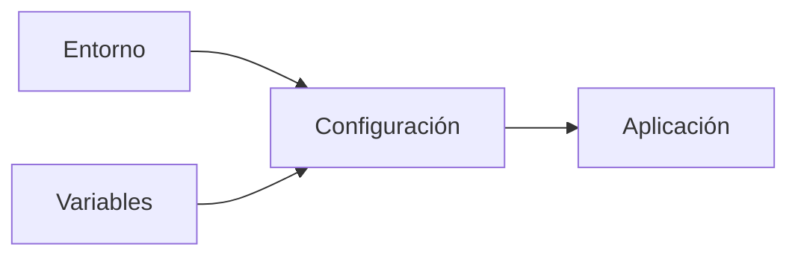
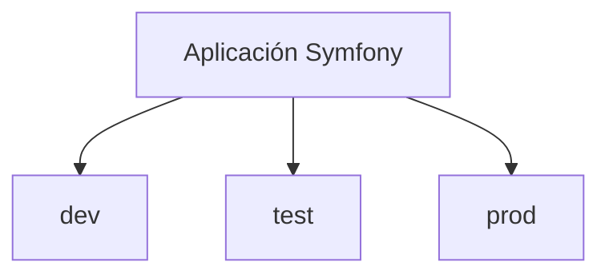
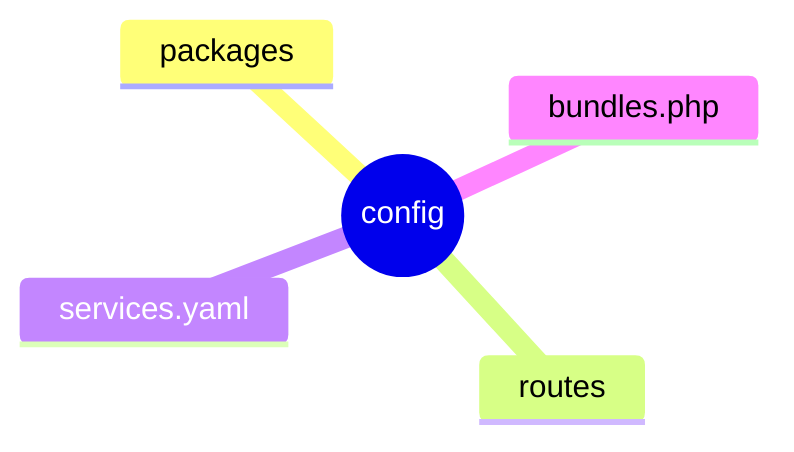

## Configuración de una aplicación Symfony

### Introducción

Una vez instalado Symfony y creado nuestro primer proyecto, es necesario comprender cómo se configura una aplicación.

Las aplicaciones modernas deben poder adaptarse a diferentes situaciones. Durante el desarrollo necesitaremos herramientas de depuración y mensajes detallados de error, mientras que en producción será necesario priorizar la seguridad y el rendimiento.

Symfony proporciona mecanismos de configuración que permiten adaptar el comportamiento de la aplicación según el entorno en el que se esté ejecutando.

En este apartado aprenderás a utilizar las variables de entorno, conocerás la estructura de configuración del framework y comprenderás la diferencia entre los principales entornos de trabajo.



!!! info "Objetivo del apartado"

    Al finalizar este tema serás capaz de comprender y configurar los elementos básicos que controlan el comportamiento de una aplicación Symfony.

### ¿Por qué es necesaria la configuración?

Todas las aplicaciones necesitan almacenar determinados parámetros que pueden variar según el lugar donde se ejecuten.

Por ejemplo:

- Datos de conexión a bases de datos.
- Dirección de servicios externos.
- Configuración de correo electrónico.
- Opciones de depuración.
- Claves de acceso.

Resultaría poco práctico modificar el código fuente cada vez que cambian estos valores.

Symfony resuelve este problema mediante un sistema de configuración flexible basado en archivos y variables de entorno.

!!! note "Idea clave"

    La configuración permite modificar el comportamiento de una aplicación sin necesidad de alterar su código fuente.

### Los entornos de trabajo

Symfony utiliza distintos entornos para adaptar el comportamiento de la aplicación.

Los más habituales son:

#### Entorno de desarrollo (dev)

Es el entorno utilizado durante la programación.

Sus características principales son:

- Muestra mensajes detallados de error.
- Facilita la depuración.
- Permite recargar automáticamente ciertos elementos.
- Proporciona información útil para los desarrolladores.

#### Entorno de producción (prod)

Es el entorno utilizado cuando la aplicación se encuentra publicada para los usuarios.

Se caracteriza por:

- Mayor rendimiento.
- Menor consumo de recursos.
- Ocultación de información sensible.
- Caché optimizada.

#### Entorno de pruebas (test)

Se utiliza para ejecutar pruebas automáticas.

Permite comprobar el correcto funcionamiento de la aplicación sin afectar al entorno de desarrollo ni al de producción.



!!! tip "Recuerda"

    Durante esta unidad trabajarás habitualmente en el entorno de desarrollo (`dev`).

---

!!! example "Actividad práctica 1. Identificando entornos"

    **Objetivo**

    Reconocer los diferentes entornos utilizados por Symfony.

    **Tareas**

    - Investiga los entornos disponibles en Symfony.
    - Explica las diferencias entre `dev`, `test` y `prod`.

    **Reflexiona**

    ¿Por qué no sería recomendable utilizar el entorno de desarrollo en una aplicación publicada en Internet?

### Variables de entorno

Las variables de entorno permiten almacenar información que puede variar entre instalaciones.

Symfony utiliza ampliamente este mecanismo para evitar que los valores de configuración dependan del código fuente.

Algunos ejemplos son:

```text
APP_ENV=dev
APP_SECRET=...
DATABASE_URL=...
```

Gracias a este enfoque podemos utilizar la misma aplicación en diferentes equipos modificando únicamente sus variables de configuración.

### El archivo .env

Uno de los archivos más importantes del proyecto es:

```text
.env
```

Este archivo contiene variables utilizadas por Symfony durante la ejecución de la aplicación.

Un ejemplo simplificado sería:

```text
APP_ENV=dev
APP_SECRET=123456789
```

### APP_ENV

Define el entorno de ejecución.

```text
APP_ENV=dev
```

Indica que la aplicación funciona en modo desarrollo.

### APP_SECRET

Contiene una clave interna utilizada por Symfony para determinadas operaciones relacionadas con la seguridad.

```text
APP_SECRET=clave_secreta
```

!!! warning "Importante"

    Las claves secretas nunca deben compartirse públicamente ni almacenarse en repositorios accesibles.

### Estructura del directorio config

Symfony organiza gran parte de su configuración dentro del directorio:

```text
config/
```

Su contenido puede variar según los componentes instalados.

Una estructura habitual es la siguiente:

```text
config/
├── packages/
├── routes/
├── services.yaml
└── bundles.php
```

### Directorio packages

Contiene la configuración específica de los distintos componentes instalados.

### Directorio routes

Almacena archivos relacionados con el sistema de rutas.

### Archivo services.yaml

Permite configurar servicios utilizados por la aplicación.

### Archivo bundles.php

Registra los componentes activos dentro del proyecto.



---

!!! example "Actividad práctica 2. Explorando la configuración"

    **Objetivo**

    Familiarizarse con los archivos de configuración.

    **Tareas**

    - Accede al directorio `config`.
    - Localiza `services.yaml`.
    - Localiza `bundles.php`.
    - Examina el contenido de ambos archivos.

    **Cuestiones**

    - ¿Qué finalidad parece tener cada fichero?
    - ¿Qué información contienen?

### Consultando variables de entorno

Symfony permite acceder a las variables de entorno desde diferentes partes de la aplicación.

Por ejemplo, es habitual utilizarlas para configurar conexiones a servicios externos o parámetros de funcionamiento.

Durante las próximas unidades veremos cómo estas variables permiten configurar bases de datos, servicios y otros componentes sin modificar el código fuente.

### Buenas prácticas de configuración

!!! tip "Buenas prácticas"

    - Mantén las claves secretas fuera del código fuente.
    - Utiliza variables de entorno para valores sensibles.
    - No modifiques archivos de configuración sin comprender su finalidad.
    - Diferencia claramente los entornos de desarrollo y producción.
    - Documenta los parámetros necesarios para desplegar la aplicación.

---

!!! example "Actividad práctica 3. Modificando variables de entorno"

    **Objetivo**

    Experimentar con la configuración básica de una aplicación Symfony.

    **Tareas**

    - Localiza el archivo `.env`.
    - Identifica la variable `APP_ENV`.
    - Comprueba el valor asignado.
    - Investiga qué ocurriría al utilizar otros entornos disponibles.

    **Reflexiona**

    ¿Por qué Symfony utiliza variables de entorno en lugar de almacenar toda la configuración directamente en el código?

### Resumen

En este apartado has aprendido que:

- Symfony utiliza sistemas de configuración para adaptar el comportamiento de la aplicación.
- Existen diferentes entornos de trabajo (`dev`, `test` y `prod`).
- El archivo `.env` almacena variables de entorno importantes.
- El directorio `config` centraliza gran parte de la configuración del framework.
- Las variables de entorno permiten separar configuración y código fuente.

!!! success "Has completado este apartado"

    Ya conoces los mecanismos básicos de configuración de Symfony. En el siguiente apartado comenzarás a desarrollar tu primera aplicación trabajando con controladores y respuestas HTTP.