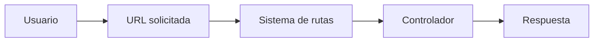
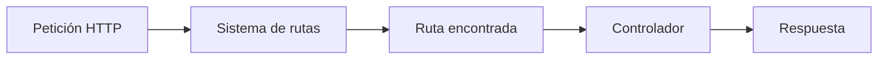
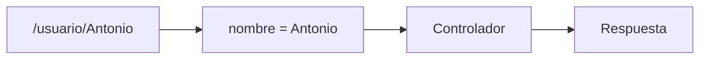
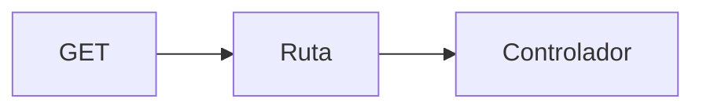
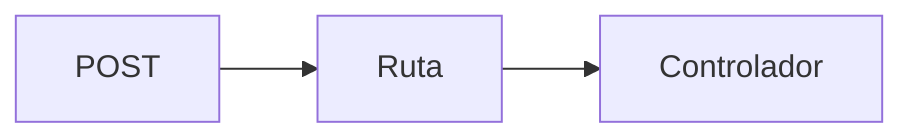
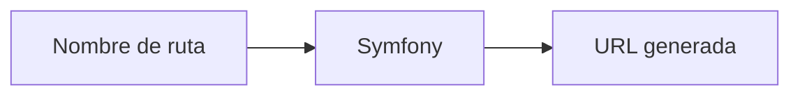

## El sistema de enrutamiento

### Introducción

En la unidad anterior creaste tus primeros controladores y comenzaste a asociar direcciones URL con determinados métodos mediante el atributo `Route`.

Aunque los ejemplos utilizados eran muy sencillos, Symfony incorpora un sistema de enrutamiento muy potente capaz de gestionar desde pequeñas aplicaciones hasta proyectos empresariales con cientos o miles de rutas.

El sistema de rutas constituye uno de los pilares fundamentales del framework. Su función consiste en determinar qué controlador debe ejecutarse cuando un usuario solicita una determinada dirección.

Gracias a este mecanismo es posible organizar la navegación de la aplicación de forma clara, mantener URLs amigables y separar el acceso a los recursos de la lógica interna de la aplicación.



!!! info "Objetivo del apartado"

    Al finalizar este tema serás capaz de definir rutas dinámicas, utilizar parámetros, aplicar restricciones, limitar métodos HTTP y generar URL dentro de una aplicación Symfony.

---

### ¿Por qué necesitamos rutas?

Cuando un usuario accede a una página web, realmente está solicitando una dirección determinada.

Por ejemplo:

```text
https://localhost:8000/productos
```

o

```text
https://localhost:8000/contacto
```

Symfony necesita saber qué código debe ejecutarse para responder a cada una de esas peticiones.

El sistema de rutas actúa como un mapa que relaciona:

- Una URL.
- Un controlador.
- Un método concreto.

Sin este mecanismo tendríamos que gestionar manualmente todas las peticiones recibidas por la aplicación.

!!! note "Idea clave"

    Una ruta conecta una URL con un método del controlador encargado de generar la respuesta.

---

### ¿Cómo funciona el sistema de enrutamiento?

Cada vez que un usuario realiza una petición, Symfony analiza todas las rutas registradas hasta encontrar una coincidencia.

Cuando encuentra una ruta compatible, ejecuta el controlador asociado.



Este proceso ocurre de forma automática en cada petición.

---

### Definición de rutas mediante atributos

La forma más habitual de definir rutas consiste en utilizar atributos PHP.

Consideremos el siguiente ejemplo:

```php
#[Route('/')]
public function inicio(): Response
{
    return new Response('Página principal');
}
```

Cuando el usuario accede a:

```text
https://localhost:8000/
```

Symfony ejecuta el método:

```php
inicio()
```

Podemos crear tantas rutas como necesitemos.

```php
#[Route('/empresa')]
public function empresa(): Response
{
    return new Response('Página de empresa');
}
```

```php
#[Route('/contacto')]
public function contacto(): Response
{
    return new Response('Página de contacto');
}
```

---

!!! example "Actividad práctica 1. Creando nuevas rutas"

    **Objetivo**

    Familiarizarse con la creación de rutas básicas.

    **Tareas**

    - Crea una ruta `/empresa`.
    - Crea una ruta `/contacto`.
    - Devuelve un mensaje diferente en cada caso.
    - Comprueba el resultado desde el navegador.

---

### Consultando las rutas disponibles

Cuando una aplicación comienza a crecer es habitual perder de vista las rutas existentes.

Symfony incorpora una herramienta muy útil para visualizar todas las rutas registradas.

```bash
php bin/console debug:router
```

La salida mostrará información similar a:

```text
Nombre        Método     Ruta
inicio        GET        /
contacto      GET        /contacto
empresa       GET        /empresa
```

Esta herramienta permite conocer:

- El nombre de la ruta.
- Los métodos HTTP permitidos.
- La URL asociada.
- El controlador que se ejecuta.

!!! tip "Herramienta imprescindible"

    El comando `debug:router` es una de las utilidades más utilizadas durante el desarrollo de aplicaciones Symfony.

---

### Rutas con parámetros

Las rutas pueden contener valores dinámicos.

Por ejemplo:

```php
#[Route('/usuario/{nombre}')]
public function usuario(string $nombre): Response
{
    return new Response("Hola $nombre");
}
```

Si el usuario accede a:

```text
/usuario/Antonio
```

Symfony asignará:

```php
$nombre = "Antonio";
```



---

!!! example "Actividad práctica 2. Trabajando con parámetros"

    **Objetivo**

    Capturar información desde la URL.

    **Tareas**

    - Crea una ruta `/usuario/{nombre}`.
    - Muestra el nombre recibido.
    - Prueba la ruta utilizando distintos valores.

    **Reflexiona**

    ¿Qué ventajas ofrece esta técnica frente a crear una ruta distinta para cada usuario?

---

### Parámetros múltiples

Una ruta puede recibir varios parámetros simultáneamente.

```php
#[Route('/producto/{id}/{nombre}')]
public function producto(
    int $id,
    string $nombre
): Response {
    return new Response(
        "Producto $id - $nombre"
    );
}
```

Accediendo a:

```text
/producto/15/teclado
```

obtendremos:

```text
Producto 15 - teclado
```

---

### Parámetros opcionales

En ocasiones algunos datos pueden no estar disponibles.

Para estos casos podemos definir valores por defecto.

```php
#[Route('/saludo/{nombre}')]
public function saludo(
    string $nombre = 'Invitado'
): Response {
    return new Response(
        "Hola $nombre"
    );
}
```

Este mecanismo resulta especialmente útil para filtros, paginación o parámetros de búsqueda.

---

!!! example "Actividad práctica 3. Parámetros opcionales"

    **Objetivo**

    Utilizar valores por defecto.

    **Tareas**

    - Crea una ruta de saludo.
    - Define un nombre por defecto.
    - Comprueba el comportamiento con distintos valores.

---

### Restricciones de rutas

No siempre queremos aceptar cualquier valor.

Symfony permite restringir los parámetros utilizando expresiones regulares.

Ejemplo:

```php
#[Route('/producto/{id<\d+>}')]
```

La expresión:

```text
\d+
```

indica que únicamente se aceptan números.

Por tanto:

```text
/producto/15
```

será válida.

Mientras que:

```text
/producto/teclado
```

no coincidirá con la ruta.

!!! note "Importancia de las restricciones"

    Las restricciones ayudan a validar datos y evitan que determinadas peticiones lleguen al controlador.

---

### Limitando métodos HTTP

Por defecto una ruta puede aceptar distintos métodos HTTP.

Sin embargo, es posible restringirlos.

Por ejemplo:

```php
#[Route(
    '/contacto',
    methods: ['GET']
)]
```

acepta únicamente peticiones GET.

También podemos utilizar:

```php
#[Route(
    '/contacto',
    methods: ['POST']
)]
```

para aceptar exclusivamente peticiones POST.

Este mecanismo resulta especialmente importante cuando trabajamos con formularios.





---

!!! example "Actividad práctica 4. Limitando métodos HTTP"

    **Objetivo**

    Comprender el funcionamiento de los métodos HTTP.

    **Tareas**

    - Crea una ruta que únicamente acepte GET.
    - Crea otra que únicamente acepte POST.
    - Comprueba qué ocurre al utilizar métodos no permitidos.

---

### Nombres de rutas

Además de una URL, cada ruta puede disponer de un identificador único.

```php
#[Route(
    '/contacto',
    name: 'contacto'
)]
```

Este nombre permite referenciar la ruta desde cualquier parte de la aplicación.

```php
#[Route(
    '/productos',
    name: 'productos'
)]
```

Los nombres deben ser:

- Únicos.
- Descriptivos.
- Fáciles de identificar.

---

### Generación de URL

Una de las ventajas de utilizar nombres de rutas es la generación automática de URL.

```php
$url = $this->generateUrl('contacto');
```

Symfony devolverá:

```text
/contacto
```

También podemos generar URL dinámicas:

```php
$url = $this->generateUrl(
    'usuario',
    ['id' => 15]
);
```



---

!!! example "Actividad práctica 5. Generando URL"

    **Objetivo**

    Generar rutas dinámicamente.

    **Tareas**

    - Asigna nombres a varias rutas.
    - Utiliza `generateUrl()`.
    - Comprueba los resultados obtenidos.

---

### Redirecciones

En determinadas situaciones necesitamos enviar al usuario a otra página.

Symfony proporciona varios mecanismos para realizar redirecciones.

La forma más habitual es:

```php
return $this->redirectToRoute(
    'contacto'
);
```

También es posible redirigir a una URL externa:

```php
return $this->redirect(
    'https://symfony.com'
);
```

Las redirecciones son muy útiles en:

- Formularios.
- Procesos de autenticación.
- Reorganización de contenidos.
- Navegación guiada.

---

### Buenas prácticas

!!! tip "Buenas prácticas"

    - Utiliza URL descriptivas.
    - Asigna nombres significativos a las rutas.
    - Aplica restricciones cuando sea necesario.
    - Limita los métodos HTTP cuando proceda.
    - Utiliza siempre la generación automática de URL.
    - Evita duplicar rutas con funcionalidades similares.

---

!!! example "Actividad práctica 6. Investigación guiada"

    **Objetivo**

    Profundizar en el sistema de rutas de Symfony.

    **Tareas**

    Consulta la documentación oficial y responde:

    - ¿Qué diferencias existen entre atributos y archivos YAML?
    - ¿Para qué sirve `debug:router`?
    - ¿Qué ventajas tienen las restricciones?
    - ¿Cuándo resulta recomendable utilizar redirecciones?

---

### Resumen

En este apartado has aprendido que:

- Las rutas conectan las URL con los controladores.
- Symfony utiliza atributos para definir rutas.
- Es posible capturar parámetros dinámicos.
- Los parámetros pueden incorporar restricciones.
- Las rutas pueden limitar los métodos HTTP permitidos.
- Symfony permite generar URL automáticamente.
- Las redirecciones facilitan la navegación entre páginas.
- El comando `debug:router` permite consultar todas las rutas registradas.

!!! success "Has completado este apartado"

    Ya dominas los fundamentos del sistema de enrutamiento de Symfony. En el siguiente tema aprenderás a utilizar Twig para generar vistas dinámicas y separar la lógica de negocio de la presentación.