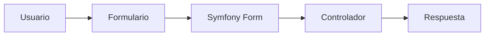
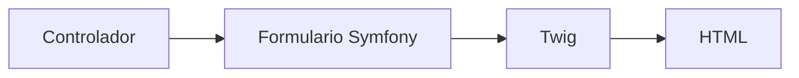
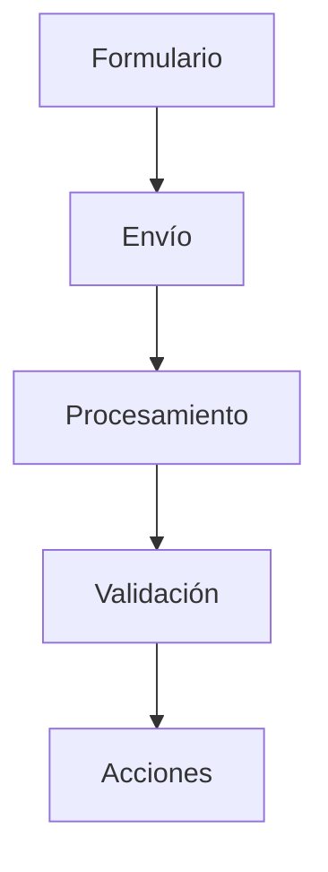
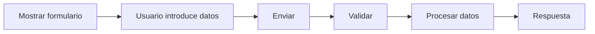

## Formularios en Symfony

### Introducción

Hasta este momento nuestras aplicaciones han mostrado información al usuario, pero todavía no hemos permitido que el usuario interactúe con ellas.

En cualquier aplicación web moderna es habitual solicitar datos mediante formularios:

- Registro de usuarios.
- Inicio de sesión.
- Formularios de contacto.
- Búsquedas.
- Gestión de productos.
- Envío de comentarios.

Symfony incorpora un potente componente denominado **Form** que facilita enormemente la creación, validación y procesamiento de formularios.

Gracias a este componente podemos construir formularios complejos manteniendo una estructura limpia y organizada.



!!! info "Objetivo del apartado"

    Al finalizar este tema serás capaz de crear formularios Symfony, procesar los datos enviados por el usuario y aplicar validaciones básicas.

---

### ¿Por qué utilizar formularios Symfony?

Podríamos crear formularios utilizando HTML puro.

Por ejemplo:

```html
<form method="post">
    <input type="text" name="nombre">
    <button>Enviar</button>
</form>
```

Sin embargo, Symfony ofrece numerosas ventajas:

- Generación automática de formularios.
- Validación integrada.
- Protección frente a ataques CSRF.
- Integración con Twig.
- Reutilización de componentes.
- Mantenimiento más sencillo.

!!! note "Idea clave"

    El componente Form permite separar la definición de los formularios de la lógica de procesamiento.

---

### Creando un formulario básico

Antes de crear formularios debemos disponer del componente correspondiente.

En aplicaciones creadas mediante:

```bash
symfony new proyecto --webapp
```

normalmente ya se encuentra instalado.

Podemos crear un formulario sencillo directamente en un controlador.

```php
use Symfony\Component\Form\Extension\Core\Type\TextType;

$form = $this->createFormBuilder()
    ->add('nombre', TextType::class)
    ->getForm();
```

En este ejemplo añadimos un campo de texto llamado:

```text
nombre
```

---

### Renderizando formularios con Twig

Una vez creado el formulario debemos enviarlo a la plantilla.

Controlador:

```php
return $this->render(
    'contacto.html.twig',
    [
        'formulario' => $form
    ]
);
```

Plantilla Twig:

```twig
{{ form(formulario) }}
```

Symfony generará automáticamente todo el código HTML necesario.



---

!!! example "Actividad práctica 1. Mi primer formulario"

    **Objetivo**

    Crear y visualizar un formulario básico.

    **Tareas**

    - Crea un formulario con un campo llamado `nombre`.
    - Envíalo a Twig.
    - Muéstralo utilizando `form()`.

    **Resultado esperado**

    Debe aparecer un campo de texto y un botón de envío.

---

### Tipos de campos

Symfony incorpora numerosos tipos de campos predefinidos.

Algunos de los más utilizados son:

| Campo | Clase |
|---------|---------|
| Texto | TextType |
| Email | EmailType |
| Número | IntegerType |
| Contraseña | PasswordType |
| Fecha | DateType |
| Casilla | CheckboxType |
| Selección | ChoiceType |
| Área de texto | TextareaType |

Ejemplo:

```php
$form = $this->createFormBuilder()
    ->add('nombre', TextType::class)
    ->add('correo', EmailType::class)
    ->add('edad', IntegerType::class)
    ->getForm();
```

---

### Personalización de campos

Los campos pueden configurarse mediante opciones.

Ejemplo:

```php
->add(
    'nombre',
    TextType::class,
    [
        'label' => 'Nombre completo'
    ]
)
```

También podemos definir:

- Valores por defecto.
- Placeholders.
- Campos obligatorios.
- Ayudas visuales.

```php
->add(
    'nombre',
    TextType::class,
    [
        'required' => true
    ]
)
```

---

### Procesamiento del formulario

Crear el formulario es solo la primera parte.

Debemos capturar los datos enviados por el usuario.

Symfony utiliza:

```php
$form->handleRequest($request);
```

Ejemplo:

```php
$form->handleRequest($request);
```

Tras procesar la petición podemos comprobar si el formulario ha sido enviado.

```php
$form->isSubmitted()
```

y si es válido:

```php
$form->isValid()
```

Proceso habitual:



---

!!! example "Actividad práctica 2. Detectando envíos"

    **Objetivo**

    Procesar la información enviada.

    **Tareas**

    - Utiliza `handleRequest()`.
    - Comprueba si el formulario ha sido enviado.
    - Muestra un mensaje de confirmación.

---

### Recuperando los datos enviados

Una vez validado el formulario podemos acceder a sus datos.

```php
$datos = $form->getData();
```

Por ejemplo:

```php
$nombre = $datos['nombre'];
```

y posteriormente mostrarlo:

```php
return new Response(
    "Hola $nombre"
);
```

---

### Validación de datos

Symfony incorpora mecanismos de validación que permiten garantizar que los datos enviados cumplen determinadas reglas.

Por ejemplo:

```php
->add(
    'correo',
    EmailType::class
)
```

obliga a introducir una dirección con formato de correo electrónico.

Además pueden utilizarse restricciones más avanzadas.

```php
use Symfony\Component\Validator\Constraints\NotBlank;
```

```php
new NotBlank()
```

Esta restricción obliga al usuario a rellenar el campo.

---

!!! example "Actividad práctica 3. Validando campos"

    **Objetivo**

    Aplicar validaciones básicas.

    **Tareas**

    - Añade un campo correo.
    - Utiliza `EmailType`.
    - Comprueba qué ocurre al introducir valores incorrectos.

---

### Mostrando errores

Si un formulario contiene errores Symfony puede mostrarlos automáticamente.

```twig
{{ form_errors(formulario) }}
```

Cada campo puede mostrar sus propios errores.

```twig
{{ form_row(formulario.nombre) }}
```

Esto mejora significativamente la experiencia del usuario.

---

### Protección CSRF

Una de las características más importantes del componente Form es su protección integrada frente a ataques CSRF.

Symfony genera automáticamente un token de seguridad que verifica que el formulario ha sido enviado desde la aplicación legítima.

!!! warning "Seguridad"

    Nunca desactives la protección CSRF sin una razón justificada. Constituye una de las principales defensas frente a determinadas amenazas web.

---

### Formularios con varios campos

Ejemplo completo:

```php
$form = $this->createFormBuilder()
    ->add('nombre', TextType::class)
    ->add('correo', EmailType::class)
    ->add('edad', IntegerType::class)
    ->add('acepta', CheckboxType::class)
    ->getForm();
```

Symfony se encarga automáticamente de generar la interfaz correspondiente.

---

!!! example "Actividad práctica 4. Formulario de contacto"

    **Objetivo**

    Crear un formulario más completo.

    **Tareas**

    Añade:

    - Nombre.
    - Correo electrónico.
    - Mensaje.
    - Botón de envío.

    **Resultado esperado**

    Un formulario similar al utilizado en las páginas de contacto profesionales.

---

### Buenas prácticas

!!! tip "Buenas prácticas"

    - Valida siempre la información recibida.
    - Utiliza tipos de campo adecuados.
    - Mantén la protección CSRF activada.
    - Muestra mensajes de error claros.
    - No confíes únicamente en las validaciones del navegador.
    - Procesa siempre la información en el servidor.

---

### Caso práctico completo

El flujo habitual de trabajo es:



---

!!! example "Actividad práctica 5. Procesando información"

    **Objetivo**

    Recuperar datos enviados mediante un formulario.

    **Tareas**

    - Crea un formulario con nombre y correo.
    - Procesa la información enviada.
    - Muestra un mensaje personalizado utilizando los valores recibidos.

---

### Formularios y aplicaciones reales

En aplicaciones profesionales los formularios permiten gestionar:

- Usuarios.
- Productos.
- Pedidos.
- Reservas.
- Comentarios.
- Incidencias.
- Configuración.

Prácticamente cualquier interacción entre usuario y aplicación termina utilizando formularios.

Por este motivo el componente Form es uno de los elementos más importantes del ecosistema Symfony.

---

!!! example "Actividad práctica 6. Investigación guiada"

    **Objetivo**

    Profundizar en el componente Form.

    **Tareas**

    Consulta la documentación oficial y responde:

    - ¿Qué ventajas ofrece el uso de clases de formulario?
    - ¿Qué diferencia existe entre `form_row()` y `form_widget()`?
    - ¿Qué es un token CSRF?
    - ¿Qué mecanismos de validación proporciona Symfony?

---

### Resumen

En este apartado has aprendido que:

- Symfony incorpora un potente componente para la gestión de formularios.
- Los formularios pueden crearse mediante `createFormBuilder()`.
- Existen numerosos tipos de campo predefinidos.
- Es posible procesar datos utilizando `handleRequest()`.
- Symfony facilita la validación de información.
- Los formularios incluyen protección CSRF integrada.
- Twig permite renderizar formularios de forma sencilla.

!!! success "Has completado este apartado"

    Ya conoces los fundamentos de los formularios en Symfony. Con los contenidos estudiados en esta unidad ya puedes desarrollar pequeñas aplicaciones Symfony utilizando controladores, rutas, vistas Twig y formularios.