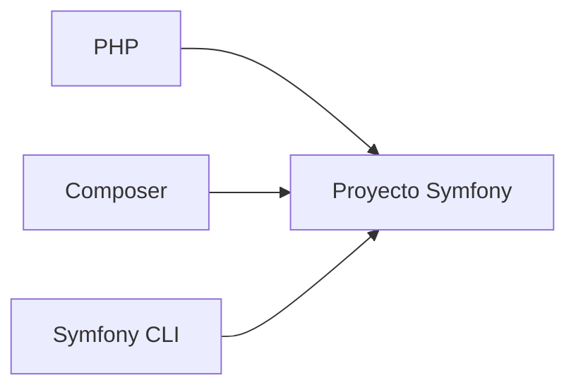
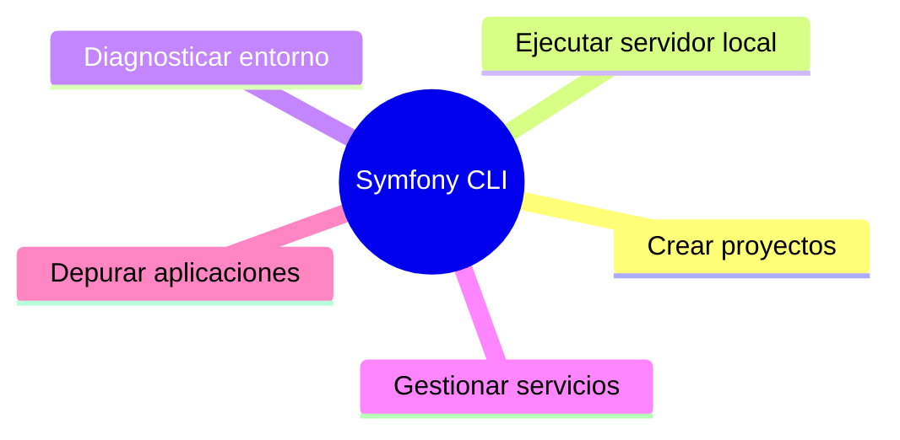
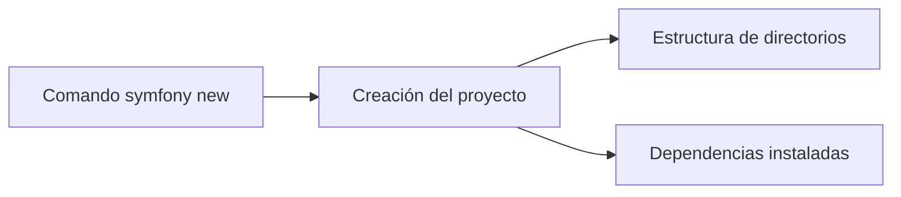

## Instalación de un proyecto Symfony

### Introducción

Una vez conocida la estructura general de Symfony, el siguiente paso consiste en preparar el entorno de desarrollo para comenzar a crear aplicaciones web.

Para ello necesitaremos varias herramientas que trabajarán conjuntamente. Algunas ya las conoces de la unidad anterior, como Composer, mientras que otras son específicas del ecosistema Symfony.

En este apartado aprenderás a verificar que tu equipo cumple los requisitos necesarios, instalar las herramientas fundamentales y crear tu primer proyecto Symfony.



!!! info "Objetivo del apartado"

    Al finalizar este tema serás capaz de crear un proyecto Symfony completamente funcional y ejecutarlo en tu equipo.

### Requisitos previos

Antes de crear una aplicación Symfony es necesario disponer de varias herramientas instaladas correctamente.

### PHP

Symfony está desarrollado en PHP, por lo que resulta imprescindible disponer de este lenguaje en nuestro sistema.

Podemos comprobar la versión instalada mediante el siguiente comando:

```bash
php -v
```

### Composer

Composer es el gestor de dependencias estándar del ecosistema PHP.

Podemos comprobar su instalación mediante:

```bash
composer --version
```

### Symfony CLI

Symfony CLI es una herramienta oficial desarrollada específicamente para facilitar el trabajo con Symfony.



### Verificación del entorno

Ejecuta los siguientes comandos:

```bash
php -v
```

```bash
composer --version
```

```bash
symfony --version
```

!!! tip "Buena práctica"

    Comprueba siempre la instalación de las herramientas antes de comenzar un proyecto.

---

## Actividad práctica 1. Comprobando el entorno

### Objetivo

Verificar que el entorno de desarrollo está correctamente preparado.

### Tareas

1. Comprueba la versión de PHP.
2. Comprueba la versión de Composer.
3. Comprueba la versión de Symfony CLI.

---

## Creación de un proyecto Symfony

```bash
symfony new mi_aplicacion --webapp
```

Este comando genera la estructura inicial del proyecto e instala las dependencias necesarias.



### Acceso al proyecto

```bash
cd mi_aplicacion
```

---

## Actividad práctica 2. Creación del primer proyecto

Crea un proyecto denominado:

```text
dwes_symfony
```

Utilizando:

```bash
symfony new dwes_symfony --webapp
```

---

## Explorando la estructura del proyecto

### Directorio src

Contiene el código fuente desarrollado por el programador.

### Directorio templates

Almacena las plantillas Twig utilizadas para generar las vistas.

### Directorio config

Contiene los archivos de configuración del framework.

### Directorio vendor

Incluye todas las dependencias instaladas mediante Composer.

!!! warning "Atención"

    El contenido de la carpeta vendor se genera automáticamente.

---

## Actividad práctica 3. Explorando el proyecto

| Elemento | Función |
|-----------|----------|
| src | |
| templates | |
| config | |
| vendor | |
| .env | |
| composer.json | |

---

## Ejecución de la aplicación

```bash
symfony server:start
```

### Comprobar el estado del servidor

```bash
symfony server:status
```

### Detener el servidor

```bash
symfony server:stop
```

---

## Actividad práctica 4. Primer arranque

1. Inicia el servidor de desarrollo.
2. Accede mediante el navegador.
3. Observa la página principal generada automáticamente por Symfony.
4. Detén el servidor.

---

## Problemas habituales

### PHP no se reconoce

Verifica la instalación y la variable PATH.

### Composer no se reconoce

Revisa la instalación de Composer.

### Symfony CLI no se reconoce

Comprueba que Symfony CLI está instalado correctamente.

---

## Actividad práctica 5. Investigación guiada

1. ¿Cuál es la última versión estable de Symfony?
2. ¿Qué requisitos mínimos de PHP exige?
3. ¿Qué diferencia existe entre `symfony new` y `composer create-project`?
4. ¿Qué función desempeña Symfony Flex?

---

## Resumen

- Symfony necesita PHP y Composer para funcionar.
- Symfony CLI simplifica la creación y gestión de proyectos.
- Es posible generar una aplicación completa mediante un único comando.
- Symfony incorpora un servidor local para el desarrollo.

!!! success "Has completado este apartado"

    Ya eres capaz de crear y ejecutar una aplicación Symfony básica.
