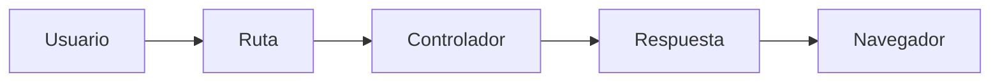
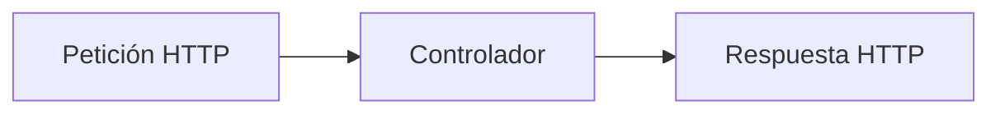
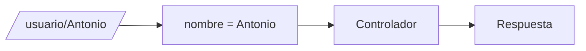

## Primera aplicación Symfony

### Introducción

Una vez instalado y configurado nuestro entorno de trabajo, ya estamos preparados para comenzar a desarrollar aplicaciones con Symfony.

En este apartado aprenderás a crear tu primer controlador, asociarlo a una ruta y generar respuestas que serán enviadas al navegador. Además, conocerás cómo Symfony procesa las peticiones de los usuarios y cómo podemos enviar información dinámica desde el servidor.

Los conceptos estudiados en este tema constituyen la base sobre la que se apoyarán los siguientes apartados de la unidad, especialmente aquellos dedicados al sistema de rutas, las plantillas Twig y los formularios.



!!! info "Objetivo del apartado"

    Al finalizar este tema serás capaz de crear controladores, definir rutas básicas y generar respuestas utilizando Symfony.

---

### El directorio src

La mayor parte del código desarrollado por el programador se almacena en el directorio:

```text
src/
```

Dentro de este directorio Symfony organiza los distintos elementos de la aplicación.

Una estructura habitual es:

```text
src/
├── Controller/
├── Entity/
├── Repository/
└── Kernel.php
```

Durante esta unidad trabajaremos principalmente con el directorio:

```text
src/Controller
```

que contiene los controladores de la aplicación.

!!! note "Recuerda"

    Los controladores son uno de los elementos más importantes de Symfony. Son los encargados de procesar las peticiones recibidas por la aplicación.

---

### ¿Qué es un controlador?

Un controlador es una clase PHP encargada de procesar una petición y generar una respuesta.

Cada vez que un usuario accede a una URL, Symfony busca qué controlador debe ejecutarse para responder a dicha petición.

Un controlador puede:

- Mostrar información.
- Procesar datos enviados por formularios.
- Consultar bases de datos.
- Generar documentos.
- Redireccionar al usuario.
- Renderizar plantillas Twig.



---

### Creando nuestro primer controlador

Los controladores suelen ubicarse dentro del directorio:

```text
src/Controller
```

Crearemos el archivo:

```text
src/Controller/HomeController.php
```

Con el siguiente contenido:

```php
<?php

namespace App\Controller;

use Symfony\Component\HttpFoundation\Response;
use Symfony\Component\Routing\Annotation\Route;

class HomeController
{
    #[Route('/')]
    public function index(): Response
    {
        return new Response('¡Hola Symfony!');
    }
}
```

Analicemos lo que está ocurriendo:

- La clase se llama `HomeController`.
- El método `index()` se ejecutará cuando accedamos a la ruta `/`.
- Devuelve un objeto `Response`.
- El objeto contiene el texto que verá el usuario.

---

!!! example "Actividad práctica 1. Mi primer controlador"

    **Objetivo**

    Crear el primer controlador de la aplicación.

    **Tareas**

    - Crea el directorio `Controller` si no existe.
    - Crea el archivo `HomeController.php`.
    - Copia el código mostrado anteriormente.
    - Inicia el servidor Symfony.
    - Accede a la ruta principal desde el navegador.

    **Resultado esperado**

    Debe mostrarse el texto:

    ```text
    ¡Hola Symfony!
    ```

---

### La clase Response

Symfony utiliza la clase:

```php
Response
```

para representar las respuestas enviadas al navegador.

Por ejemplo:

```php
return new Response('Hola mundo');
```

genera una respuesta HTTP cuyo contenido será:

```text
Hola mundo
```

La clase permite además:

- Modificar cabeceras HTTP.
- Establecer códigos de estado.
- Enviar contenido HTML.
- Gestionar redirecciones.

!!! tip "Idea clave"

    Cualquier controlador Symfony debe devolver un objeto Response o una clase equivalente.

---

### Definiendo rutas mediante atributos

Symfony utiliza rutas para asociar URLs con métodos de los controladores.

La ruta de nuestro ejemplo es:

```php
#[Route('/')]
```

Esto significa:

```text
https://localhost:8000/
```

Cuando el usuario accede a esa dirección se ejecuta el método correspondiente.

Podemos crear nuevas rutas fácilmente.

```php
#[Route('/saludo')]
```

Ahora la URL será:

```text
https://localhost:8000/saludo
```

---

!!! example "Actividad práctica 2. Creando una nueva ruta"

    **Objetivo**

    Crear rutas adicionales dentro del controlador.

    **Tareas**

    Añade un segundo método:

    ```php
    #[Route('/saludo')]
    public function saludo(): Response
    {
        return new Response('Bienvenido a Symfony');
    }
    ```

    Comprueba su funcionamiento desde el navegador.

---

### Nuestra primera página Symfony

Vamos a crear una página más elaborada.

```php
#[Route('/acerca')]
public function acerca(): Response
{
    return new Response("
        <h1>DWES</h1>
        <p>Mi primera aplicación Symfony</p>
    ");
}
```

Al acceder a:

```text
/acerca
```

el navegador mostrará contenido HTML generado desde el controlador.

Aunque esta técnica resulta útil para comprender el funcionamiento interno de Symfony, más adelante aprenderemos a utilizar Twig para separar la lógica de la presentación.

---

### Rutas con parámetros

Symfony permite capturar valores directamente desde la URL.

Por ejemplo:

```php
#[Route('/usuario/{nombre}')]
public function usuario(string $nombre): Response
{
    return new Response("Hola $nombre");
}
```

Si accedemos a:

```text
/usuario/Antonio
```

obtendremos:

```text
Hola Antonio
```



---

!!! example "Actividad práctica 3. Probando rutas con parámetros"

    **Objetivo**

    Utilizar parámetros enviados mediante la URL.

    **Tareas**

    - Crea una ruta llamada `/usuario/{nombre}`.
    - Muestra un saludo personalizado.
    - Prueba la ruta utilizando distintos nombres.

    **Reflexiona**

    ¿Qué ventajas ofrece utilizar parámetros frente a crear una ruta distinta para cada usuario?

---

### Enviando información dinámica

Una de las ventajas de los controladores es que pueden generar respuestas diferentes dependiendo de los datos recibidos.

Por ejemplo:

```php
#[Route('/edad/{edad}')]
public function edad(int $edad): Response
{
    return new Response("Tu edad es $edad años");
}
```

Symfony convierte automáticamente el valor recibido desde la URL en el tipo indicado.

---

!!! example "Actividad práctica 4. Mostrando información dinámica"

    **Objetivo**

    Procesar datos recibidos desde la URL.

    **Tareas**

    - Crea una ruta `/edad/{edad}`.
    - Muestra la edad recibida.
    - Prueba diferentes valores.

    **Cuestiones**

    - ¿Qué ocurre si introduces un texto en lugar de un número?
    - ¿Cómo podríamos validar los datos recibidos?

---

### Introducción al método render()

Aunque todavía estudiaremos Twig con detalle en los próximos temas, es importante conocer que la mayoría de controladores Symfony no generan HTML directamente mediante la clase Response.

Habitualmente utilizan el método:

```php
render()
```

para delegar la presentación en una plantilla Twig.

La idea general es:

```php
return $this->render('inicio.html.twig');
```

Esta separación mejora la organización del proyecto y facilita el mantenimiento del código.

---

!!! example "Actividad práctica 5. Analizando respuestas"

    **Objetivo**

    Comprender el funcionamiento de la clase Response.

    **Tareas**

    Modifica el contenido de las respuestas generadas por tus controladores.

    Prueba:

    - Texto simple.
    - Etiquetas HTML.
    - Mensajes personalizados.

    **Reflexiona**

    ¿Qué tipo de contenido puede enviarse mediante una respuesta HTTP?

---

### Buenas prácticas

!!! tip "Buenas prácticas"

    - Utiliza nombres descriptivos para los controladores.
    - Mantén cada controlador centrado en una responsabilidad concreta.
    - Evita generar grandes bloques HTML directamente desde PHP.
    - Utiliza rutas claras y fáciles de entender.
    - Aprovecha Twig para generar las vistas de la aplicación.

---

!!! example "Actividad práctica 6. Investigación guiada"

    **Objetivo**

    Explorar la documentación oficial de Symfony.

    **Tareas**

    Investiga y responde:

    - ¿Qué diferencias existen entre atributos y archivos de rutas?
    - ¿Qué otros tipos de respuestas permite Symfony?
    - ¿Qué ventajas ofrece Twig frente a generar HTML directamente desde PHP?
    - ¿Qué función desempeña la clase AbstractController?

---

### Resumen

En este apartado has aprendido que:

- Los controladores procesan las peticiones de los usuarios.
- Symfony utiliza rutas para asociar URLs con métodos.
- La clase Response permite generar respuestas HTTP.
- Es posible capturar parámetros desde la URL.
- Los controladores pueden generar contenido dinámico.
- Twig permitirá separar la lógica de negocio de la presentación.

!!! success "Has completado este apartado"

    Ya eres capaz de construir una aplicación Symfony básica utilizando controladores y rutas. En el siguiente apartado profundizarás en el sistema de enrutamiento y aprenderás a definir rutas más avanzadas.