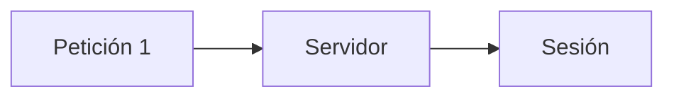
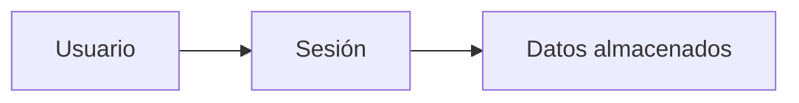
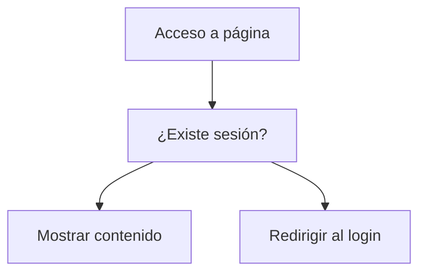
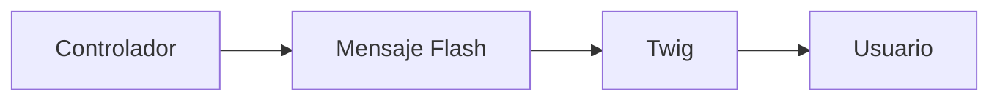
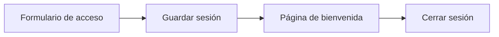
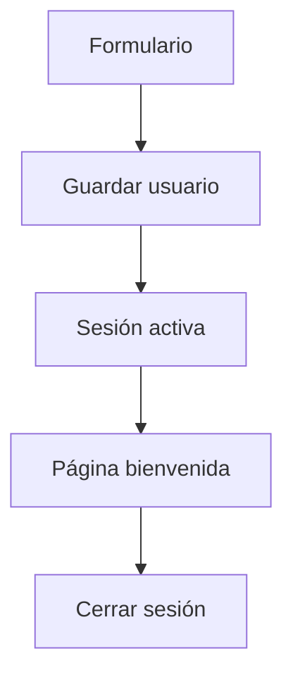

## Sesiones y mensajes Flash

### Introducción

Hasta ahora nuestras aplicaciones han sido capaces de procesar peticiones, mostrar información dinámica e interactuar con los usuarios mediante formularios.

Sin embargo, existe un problema importante: HTTP es un protocolo sin estado. Esto significa que cada petición que realiza el navegador es independiente de las anteriores.

Por ejemplo, si un usuario se identifica en una página web, el servidor no recordará automáticamente quién es durante la siguiente petición.

Para resolver este problema utilizamos las sesiones.

Las sesiones permiten almacenar información asociada a un usuario concreto y recuperarla posteriormente durante su navegación por la aplicación.



!!! info "Objetivo del apartado"

    Al finalizar este tema serás capaz de utilizar sesiones y mensajes Flash en Symfony para almacenar información entre peticiones y mejorar la interacción con el usuario.

---

### ¿Qué es una sesión?

Una sesión es un mecanismo que permite almacenar información de un usuario entre distintas peticiones HTTP.

Gracias a las sesiones, Symfony puede recordar información importante durante la navegación.

Algunos usos habituales son:

- Mantener un usuario identificado.
- Gestionar carritos de compra.
- Almacenar preferencias.
- Controlar permisos.
- Gestionar procesos de navegación.

!!! note "Recuerda"

    Sin sesiones, cada petición sería completamente independiente y el servidor no podría recordar información del usuario.

---

### Funcionamiento de una sesión

Cuando un usuario accede por primera vez a la aplicación, Symfony crea un identificador único asociado a dicho usuario.

A partir de ese momento la información almacenada en la sesión estará disponible durante toda la navegación.



---

### Accediendo a la sesión

Para trabajar con sesiones necesitaremos acceder al objeto sesión a través de la petición.

```php
use Symfony\Component\HttpFoundation\Request;
```

Ejemplo:

```php
$session = $request->getSession();
```

A partir de este objeto podremos guardar, recuperar y eliminar información.

---

### Guardar datos en una sesión

Symfony permite almacenar datos utilizando el método:

```php
$session->set();
```

Ejemplo:

```php
$session->set(
    'usuario',
    'Pedro'
);
```

En este caso se almacena el usuario identificado.

---

!!! example "Actividad práctica 1. Guardando información en la sesión"

    **Objetivo**

    Aprender a almacenar información en una sesión.

    **Tareas**

    - Crea una ruta llamada `/guardar`.
    - Almacena un nombre de usuario en la sesión.
    - Muestra un mensaje indicando que la información se ha guardado correctamente.

---

### Recuperar datos de una sesión

La información puede recuperarse mediante:

```php
$session->get();
```

Ejemplo:

```php
$usuario = $session->get('usuario');
```

Posteriormente podremos utilizar dicha información en la aplicación.

```php
return new Response(
    "Usuario: $usuario"
);
```

---

!!! example "Actividad práctica 2. Recuperando información"

    **Objetivo**

    Leer información almacenada previamente.

    **Tareas**

    - Crea una ruta llamada `/perfil`.
    - Recupera el usuario guardado en sesión.
    - Muestra su nombre en la respuesta.

---

### Comprobar si existe un dato

En ocasiones necesitaremos comprobar si la sesión contiene una determinada información.

Symfony proporciona:

```php
$session->has();
```

Ejemplo:

```php
if ($session->has('usuario')) {

}
```

Esto resulta especialmente útil para controlar accesos.

---

### Eliminar información de una sesión

Podemos eliminar un valor concreto.

```php
$session->remove('usuario');
```

A partir de ese momento el dato dejará de estar disponible.

---

### Invalidar una sesión

Si queremos cerrar completamente una sesión podemos utilizar:

```php
$session->invalidate();
```

Esto elimina toda la información almacenada.

Ejemplo típico:

```php
$session->invalidate();

return $this->redirectToRoute(
    'login'
);
```

---

!!! example "Actividad práctica 3. Cerrando sesión"

    **Objetivo**

    Eliminar los datos almacenados.

    **Tareas**

    - Crea una ruta `/logout`.
    - Elimina el usuario almacenado.
    - Redirige al usuario a la página principal.

---

### Página protegida mediante sesión

Una situación habitual es impedir el acceso a determinadas páginas si el usuario no ha iniciado sesión.

Ejemplo:

```php
if (!$session->has('usuario')) {

    return $this->redirectToRoute(
        'login'
    );
}
```

Esto obliga al usuario a identificarse previamente.



---

!!! example "Actividad práctica 4. Página protegida"

    **Objetivo**

    Controlar el acceso a una página.

    **Tareas**

    - Crea una ruta protegida.
    - Comprueba si existe un usuario almacenado.
    - Si no existe, redirige a una página de acceso.

---

### ¿Qué son los mensajes Flash?

Los mensajes Flash son mensajes temporales almacenados en la sesión.

Se utilizan habitualmente para informar al usuario sobre el resultado de una acción.

Ejemplos:

- Inicio de sesión correcto.
- Datos guardados correctamente.
- Error de validación.
- Operación completada.

La principal característica es que se muestran una sola vez.

---

### Crear mensajes Flash

Symfony permite generar mensajes de forma muy sencilla.

```php
$this->addFlash(
    'success',
    'Sesión iniciada correctamente'
);
```

Otros tipos frecuentes son:

```php
success
```

```php
warning
```

```php
error
```

```php
info
```

---

### Mostrar mensajes Flash en Twig

Para visualizar los mensajes utilizaremos Twig.

Ejemplo:

```twig

    <div class="alert alert-success">
        {{ mensaje }}
    </div>

```

El mensaje desaparecerá automáticamente tras ser mostrado.



---

!!! example "Actividad práctica 5. Mensajes Flash"

    **Objetivo**

    Utilizar mensajes temporales.

    **Tareas**

    - Crea un mensaje Flash de éxito.
    - Muéstralo mediante Twig.
    - Comprueba que desaparece al recargar la página.

---

### Buenas prácticas

!!! tip "Buenas prácticas"

    - Utiliza sesiones únicamente para información necesaria.
    - Evita almacenar grandes cantidades de datos.
    - Cierra la sesión cuando ya no sea necesaria.
    - Utiliza mensajes Flash para informar al usuario sobre acciones importantes.
    - Comprueba siempre la existencia de la información antes de utilizarla.

---

!!! example "Actividad práctica 6. Investigación guiada"

    **Objetivo**

    Profundizar en la gestión de sesiones.

    **Tareas**

    Consulta la documentación oficial de Symfony y responde:

    - ¿Qué diferencia existe entre `remove()` e `invalidate()`?
    - ¿Dónde almacena Symfony la información de las sesiones?
    - ¿Qué ventajas aportan los mensajes Flash?
    - ¿Qué riesgos existen si se almacena demasiada información en la sesión?

---
## Práctica guiada: Sistema de acceso con sesiones

En esta práctica desarrollarás una pequeña aplicación capaz de:

- Solicitar un nombre de usuario.
- Almacenar dicho nombre en una sesión.
- Mostrar una página de bienvenida personalizada.
- Utilizar mensajes Flash.
- Cerrar la sesión del usuario.

Esta práctica servirá como preparación para la actividad evaluable de la unidad.



---

### Paso 1. Crear el controlador

Crea un controlador denominado:

```text
LoginController
```

que contendrá las siguientes rutas:

```text
/login
```

```text
/bienvenida
```

```text
/logout
```

---

### Paso 2. Crear el formulario

Crea una clase de formulario:

```text
src/Form/LoginType.php
```

El formulario contendrá:

- Nombre de usuario.
- Botón de envío.

Ejemplo:

```php
<?php

namespace App\Form;

use Symfony\Component\Form\AbstractType;
use Symfony\Component\Form\Extension\Core\Type\TextType;
use Symfony\Component\Form\Extension\Core\Type\SubmitType;
use Symfony\Component\Form\FormBuilderInterface;

class LoginType extends AbstractType
{
    public function buildForm(
        FormBuilderInterface $builder,
        array $options
    ): void {

        $builder
            ->add('usuario', TextType::class)
            ->add('entrar', SubmitType::class);
    }
}
```

---

### Paso 3. Mostrar el formulario

En el controlador:

```php
$form = $this->createForm(
    LoginType::class
);

$form->handleRequest($request);
```

Cuando el formulario se envíe correctamente:

```php
if (
    $form->isSubmitted() &&
    $form->isValid()
) {

}
```

obtén el nombre del usuario.

---

### Paso 4. Guardar información en la sesión

Una vez obtenido el usuario:

```php
$datos = $form->getData();

$session->set(
    'usuario',
    $datos['usuario']
);
```

Añade también un mensaje Flash:

```php
$this->addFlash(
    'success',
    'Sesión iniciada correctamente.'
);
```

---

### Paso 5. Redireccionar

Cuando el acceso sea correcto:

```php
return $this->redirectToRoute(
    'bienvenida'
);
```

---

### Paso 6. Crear la página de bienvenida

Comprueba si existe sesión:

```php
if (
    !$session->has('usuario')
) {

    return $this->redirectToRoute(
        'login'
    );
}
```

Recupera los datos:

```php
$usuario = $session->get('usuario');
```

y envíalos a Twig:

```php
return $this->render(
    'login/bienvenida.html.twig',
    [
        'usuario' => $usuario
    ]
);
```

---

### Paso 7. Mostrar mensajes Flash

Dentro de la plantilla:

```twig


    <div class="alert">
        {{ mensaje }}
    </div>


```

---

### Paso 8. Crear el cierre de sesión

En la ruta:

```text
/logout
```

elimina la información almacenada.

```php
$session->remove('usuario');
```

Añade un mensaje Flash:

```php
$this->addFlash(
    'info',
    'Sesión cerrada correctamente.'
);
```

Finalmente:

```php
return $this->redirectToRoute(
    'login'
);
```

---

### Resultado esperado

La aplicación deberá funcionar de la siguiente manera:



---

### Resumen

En este apartado has aprendido que:

- Las sesiones permiten mantener información entre peticiones HTTP.
- Symfony facilita la gestión de sesiones mediante el objeto Session.
- Es posible guardar, recuperar y eliminar información.
- Las sesiones permiten proteger páginas y gestionar usuarios identificados.
- Los mensajes Flash proporcionan información temporal al usuario.
- Twig permite mostrar fácilmente los mensajes Flash en las vistas.

!!! success "Has completado este apartado"

    Ya sabes utilizar sesiones y mensajes Flash en Symfony. Con este conocimiento dispones de todos los elementos necesarios para desarrollar pequeñas aplicaciones completas utilizando controladores, rutas, Twig, formularios y gestión de usuarios.