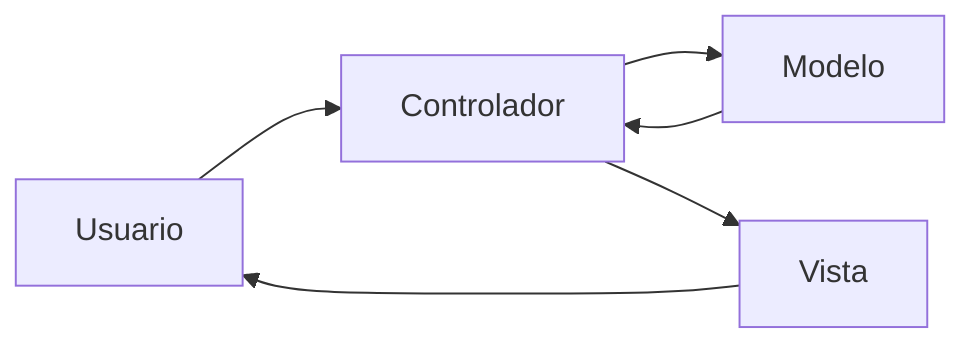
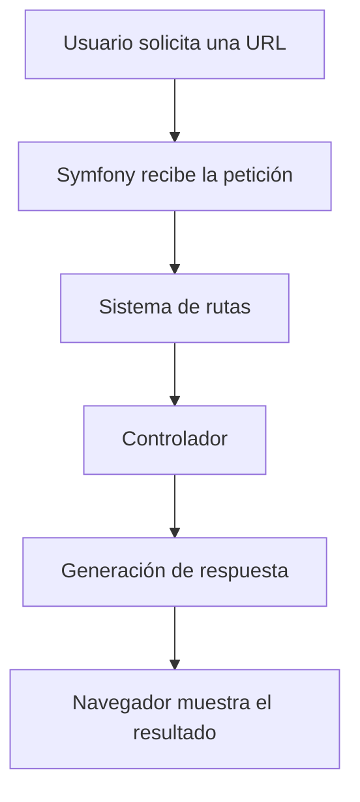
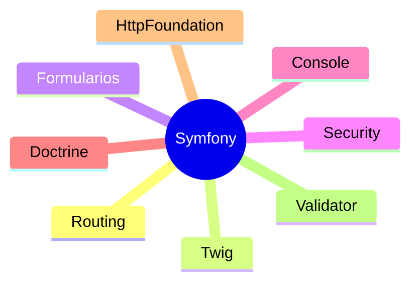

## Symfony como framework PHP

### Introducción

En la unidad anterior descubriste qué es un framework y cuáles son las ventajas que aporta al desarrollo de aplicaciones web. También realizaste una primera aproximación a Symfony dentro del ecosistema PHP.

En esta unidad comenzaremos a trabajar con Symfony de forma práctica. Antes de instalar nuestro primer proyecto conviene comprender cómo está organizado el framework, cuáles son sus componentes principales y de qué forma se estructura una aplicación desarrollada con esta tecnología.

Symfony proporciona una arquitectura sólida que permite desarrollar aplicaciones mantenibles, escalables y preparadas para crecer con el tiempo. Gracias a ella, los desarrolladores pueden concentrarse en resolver las necesidades del proyecto sin tener que implementar continuamente funcionalidades comunes.

!!! info "Symfony en pocas palabras"

    Symfony es un framework PHP profesional que proporciona una estructura de trabajo organizada y un conjunto de componentes reutilizables para desarrollar aplicaciones web modernas.

### Symfony dentro del ecosistema PHP

Actualmente Symfony es uno de los frameworks más utilizados en el desarrollo profesional con PHP.

Muchas aplicaciones empresariales utilizan Symfony de forma completa, mientras que otras emplean únicamente algunos de sus componentes. De hecho, herramientas y proyectos muy conocidos dentro del ecosistema PHP incorporan componentes desarrollados originalmente para Symfony.

Una de las razones de su éxito es su diseño modular. Cada componente puede utilizarse de manera independiente o junto al resto del framework.

Algunos de los beneficios más importantes que ofrece Symfony son:

- Organización clara del proyecto.
- Separación de responsabilidades.
- Reutilización de código.
- Mayor seguridad.
- Facilidad de mantenimiento.
- Cumplimiento de estándares profesionales.
- Amplia documentación y comunidad.

!!! tip "Idea clave"

    Symfony no pretende que desarrolles menos código, sino que dediques más tiempo a implementar las necesidades específicas del proyecto y menos a resolver problemas repetitivos.

### Arquitectura MVC en Symfony

Como estudiaste en la unidad anterior, Symfony sigue el patrón de arquitectura Modelo-Vista-Controlador (MVC).

Este patrón divide una aplicación en varios elementos especializados:

- El **Modelo** gestiona los datos y la lógica de negocio.
- La **Vista** muestra la información al usuario.
- El **Controlador** procesa las peticiones y coordina el funcionamiento de la aplicación.

Gracias a esta separación cada componente tiene una responsabilidad concreta, lo que facilita la organización y el mantenimiento del código.



!!! note "Recuerda"

    MVC no es exclusivo de Symfony. Se trata de uno de los patrones arquitectónicos más utilizados en el desarrollo de aplicaciones web.

### El ciclo de una petición

Cada vez que un usuario accede a una página web se produce una petición HTTP al servidor.

Symfony procesa estas peticiones siguiendo una secuencia perfectamente definida.

1. El navegador solicita una URL.
2. Symfony recibe la petición.
3. El sistema de rutas localiza el controlador adecuado.
4. El controlador ejecuta la lógica necesaria.
5. Se genera una respuesta.
6. El servidor devuelve el resultado al navegador.



!!! tip "Importante"

    Comprender el ciclo de petición y respuesta es fundamental para entender el funcionamiento de las rutas, controladores y vistas que estudiaremos en los próximos apartados.

### Componentes principales de Symfony



### Estructura de un proyecto Symfony

```text
mi_proyecto/
├── config/
├── public/
├── src/
├── templates/
├── var/
├── vendor/
├── .env
└── composer.json
```

#### Directorio src

Contiene el código fuente desarrollado por el programador.

#### Directorio templates

Almacena las plantillas Twig utilizadas para generar las páginas HTML.

#### Directorio config

Contiene la configuración del framework.

#### Directorio public

Es el punto de entrada público de la aplicación.

#### Directorio var

Almacena archivos temporales.

#### Directorio vendor

Contiene las dependencias instaladas mediante Composer.

!!! warning "Atención"

    El directorio vendor se genera automáticamente y no debe modificarse manualmente.

### Archivos importantes

#### composer.json

Define las dependencias del proyecto.

#### .env

Permite almacenar variables de entorno.


!!! note "Recuerda"

    Las variables de entorno permiten separar la configuración del código fuente.

### Resumen

- Symfony es uno de los frameworks PHP más utilizados.
- Se basa en la arquitectura MVC.
- Utiliza un ciclo de petición y respuesta.
- Organiza los proyectos mediante una estructura definida.
- Emplea archivos como composer.json y .env.

!!! success "Has completado este apartado"

    Ya conoces la estructura general de Symfony. En el siguiente apartado aprenderás a instalar las herramientas necesarias y crear tu primer proyecto.
