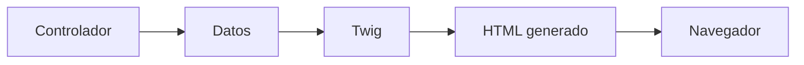
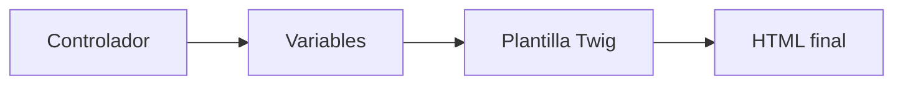
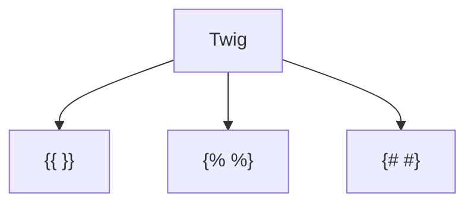
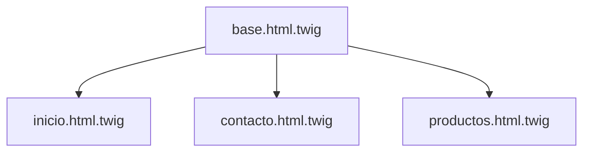

## El motor de plantillas Twig

### Introducción

Hasta ahora hemos generado respuestas directamente desde los controladores mediante la clase `Response`.

Por ejemplo:

```php
return new Response(
    "<h1>Bienvenido a Symfony</h1>"
);
```

Aunque este método resulta útil para comprender el funcionamiento interno del framework, presenta varias limitaciones cuando las aplicaciones comienzan a crecer.

Mezclar código PHP y código HTML dificulta el mantenimiento, complica la reutilización y hace más difícil la colaboración entre desarrolladores y diseñadores.

Para resolver este problema Symfony incorpora **Twig**, un motor de plantillas moderno, flexible y sencillo de utilizar.

Twig permite separar claramente la lógica de la aplicación de la presentación visual, siguiendo las buenas prácticas de la arquitectura MVC.



!!! info "Objetivo del apartado"

    Al finalizar este tema serás capaz de crear plantillas Twig, mostrar información dinámica, utilizar estructuras de control y construir interfaces reutilizables mediante herencia de plantillas.

---

### ¿Qué es Twig?

Twig es el motor de plantillas utilizado por Symfony para generar las vistas de una aplicación.

Su función consiste en transformar una plantilla y los datos enviados por el controlador en una página HTML que pueda ser interpretada por el navegador.

En lugar de escribir directamente HTML dentro del controlador, el controlador enviará los datos necesarios a una plantilla Twig.



Esta separación aporta numerosas ventajas:

- Código más organizado.
- Mayor reutilización.
- Mantenimiento más sencillo.
- Mejor legibilidad.
- Separación entre lógica y presentación.

---

### Ubicación de las plantillas

Las plantillas se almacenan en el directorio:

```text
templates/
```

Por ejemplo:

```text
templates/
├── base.html.twig
├── inicio.html.twig
├── contacto.html.twig
└── productos.html.twig
```

Cada archivo representa una vista de la aplicación.

La extensión habitual es:

```text
.html.twig
```

---

### Renderizando una plantilla

Para mostrar una plantilla desde un controlador utilizamos el método:

```php
return $this->render('inicio.html.twig');
```

Ejemplo completo:

```php
#[Route('/')]
public function inicio(): Response
{
    return $this->render(
        'inicio.html.twig'
    );
}
```

Plantilla:

```twig
<h1>Bienvenido a Symfony</h1>
<p>Mi primera plantilla Twig.</p>
```

Al acceder a la ruta correspondiente Symfony generará la página HTML automáticamente.

---

!!! example "Actividad práctica 1. Mi primera plantilla Twig"

    **Objetivo**

    Crear y visualizar una plantilla Twig.

    **Tareas**

    - Crea el archivo `inicio.html.twig`.
    - Añade un encabezado y un párrafo.
    - Modifica el controlador para utilizar `render()`.
    - Comprueba el resultado en el navegador.

---

### Sintaxis básica de Twig

Twig utiliza tres construcciones fundamentales.

#### Mostrar variables

```twig
{{ variable }}
```

#### Estructuras de control

```twig


```

#### Comentarios

```twig
{# Comentario #}
```



---

### Mostrando variables

Los controladores pueden enviar datos a las plantillas.

Controlador:

```php
#[Route('/saludo')]
public function saludo(): Response
{
    return $this->render(
        'saludo.html.twig',
        [
            'nombre' => 'Antonio'
        ]
    );
}
```

Plantilla:

```twig
<h1>Hola {{ nombre }}</h1>
```

Resultado:

```html
<h1>Hola Antonio</h1>
```

---

!!! example "Actividad práctica 2. Mostrando variables"

    **Objetivo**

    Enviar datos desde un controlador.

    **Tareas**

    - Crea una variable llamada `curso`.
    - Asígnale el valor `DWES`.
    - Muéstrala dentro de una plantilla Twig.

    **Resultado esperado**

    ```html
    DWES
    ```

---

### Expresiones

Twig permite trabajar con expresiones sencillas.

Ejemplos:

```twig
{{ 5 + 2 }}
```

```twig
{{ nombre ~ " García" }}
```

```twig
{{ edad * 2 }}
```

Resultado:

```html
7
Antonio García
36
```

---

### Condicionales

Twig incorpora estructuras de decisión similares a PHP.

```twig

    <p>Mayor de edad</p>

    <p>Menor de edad</p>

```

También es posible utilizar:

```twig

```

para evaluar múltiples condiciones.

---

!!! example "Actividad práctica 3. Utilizando condicionales"

    **Objetivo**

    Mostrar contenido en función de una condición.

    **Tareas**

    - Envía una variable llamada `nota`.
    - Si la nota es mayor o igual que 5 muestra "Aprobado".
    - En caso contrario muestra "Suspenso".

---

### Bucles

Twig permite recorrer colecciones mediante la estructura:

```twig


```

Ejemplo:

```twig
<ul>

    <li>{{ modulo }}</li>

</ul>
```

Si:

```php
[
    'DWES',
    'DIW',
    'DAW'
]
```

se obtendrá:

```html
<ul>
    <li>DWES</li>
    <li>DIW</li>
    <li>DAW</li>
</ul>
```

---

!!! example "Actividad práctica 4. Generando listas"

    **Objetivo**

    Utilizar bucles en Twig.

    **Tareas**

    - Crea un array con varios módulos.
    - Envíalo desde el controlador.
    - Genera una lista HTML mediante un bucle `for`.

    **Reflexiona**

    ¿Qué ventajas ofrece generar la lista automáticamente?

---

### Comentarios

Twig permite añadir comentarios que no serán enviados al navegador.

```twig
{# Este comentario no aparecerá en el HTML #}
```

Se utilizan para documentar las plantillas.

---

### Filtros

Los filtros permiten transformar valores.

Se aplican mediante el símbolo:

```twig
|
```

Ejemplos:

```twig
{{ nombre|upper }}
```

```twig
{{ nombre|lower }}
```

```twig
{{ nombre|title }}
```

Resultado:

```text
ANTONIO
antonio
Antonio
```

Algunos filtros frecuentes:

| Filtro | Función |
|----------|----------|
| upper | Mayúsculas |
| lower | Minúsculas |
| title | Capitalizar |
| length | Longitud |
| date | Formatear fechas |

---

### Herencia de plantillas

Una de las características más potentes de Twig es la herencia.

Permite crear una plantilla base reutilizable.

Archivo:

```twig
base.html.twig
```

```twig
<!DOCTYPE html>
<html>
<head>
    <title>
        
        Symfony
        
    </title>
</head>
<body>




</body>
</html>
```

Otra plantilla puede extenderla:

```twig

```

y redefinir únicamente las partes necesarias.

```twig

<h1>Página de inicio</h1>

```



---

!!! example "Actividad práctica 5. Creando una plantilla base"

    **Objetivo**

    Utilizar herencia de plantillas.

    **Tareas**

    - Crea un archivo `base.html.twig`.
    - Define los bloques `title` y `body`.
    - Crea una segunda plantilla que extienda la anterior.
    - Personaliza únicamente el contenido del bloque `body`.

---

### Inclusión de fragmentos

También es posible reutilizar partes comunes mediante:

```twig
{{ include('menu.html.twig') }}
```

Esta técnica resulta muy útil para:

- Menús.
- Cabeceras.
- Pies de página.
- Barras laterales.

Permite evitar la duplicación de código.

---

### Funciones útiles

Twig incorpora numerosas funciones predefinidas.

Algunas de las más utilizadas son:

```twig
{{ path('contacto') }}
```

Genera una URL utilizando el nombre de una ruta.

```twig
{{ asset('images/logo.png') }}
```

Genera la URL de un recurso estático.

```twig
{{ dump(variable) }}
```

Muestra información de depuración durante el desarrollo.

---

### Buenas prácticas

!!! tip "Buenas prácticas"

    - Mantén la lógica compleja fuera de las plantillas.
    - Utiliza siempre herencia cuando existan elementos comunes.
    - Emplea nombres descriptivos para las variables.
    - Reutiliza fragmentos mediante `include()`.
    - Evita duplicar código HTML.

---

!!! example "Actividad práctica 6. Investigación guiada"

    **Objetivo**

    Conocer mejor las capacidades de Twig.

    **Tareas**

    Consulta la documentación oficial y responde:

    - ¿Qué diferencia existe entre `include()` y `extends`?
    - ¿Qué otros filtros incorpora Twig?
    - ¿Para qué sirve la función `path()`?
    - ¿Qué ventajas aporta Twig frente a escribir HTML directamente desde PHP?

---

### Resumen

En este apartado has aprendido que:

- Twig es el motor de plantillas utilizado por Symfony.
- Permite separar la lógica de la presentación.
- Los controladores envían datos a las plantillas mediante `render()`.
- Es posible mostrar variables, utilizar condiciones y recorrer colecciones.
- Los filtros permiten transformar información fácilmente.
- La herencia de plantillas favorece la reutilización.
- Las funciones Twig simplifican numerosas tareas habituales.

!!! success "Has completado este apartado"

    Ya sabes crear vistas dinámicas utilizando Twig. En el siguiente apartado aprenderás a crear formularios y procesar información enviada por los usuarios.